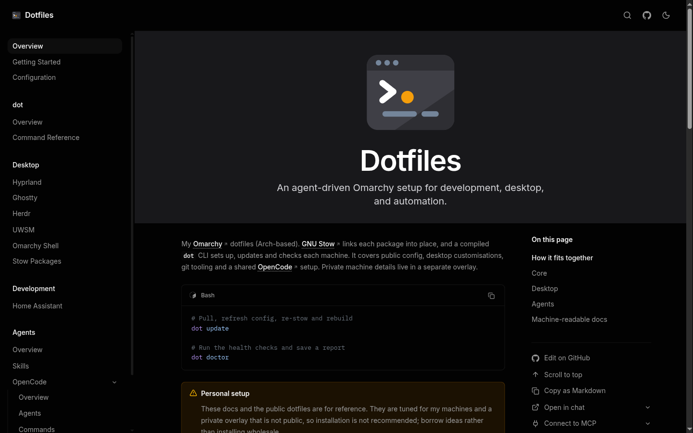
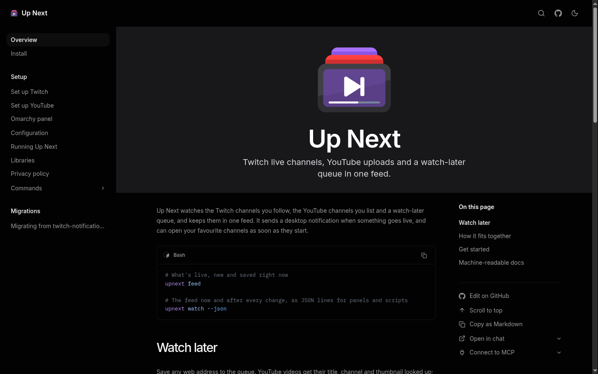
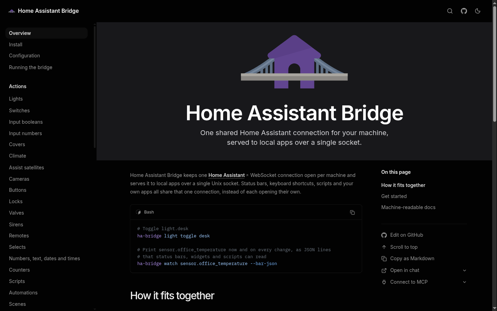
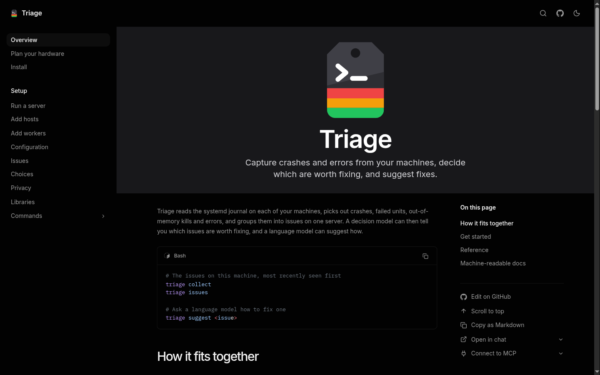

# Groundwork

One design and architecture system for my apps, sites, CLIs, terminal UIs,
Omarchy panels and agents: how they look, how they behave and how they're put
together. Every app starts from the same base and adds its own theme, so they
stay related without all looking the same.

It's early. Today the repo holds [`@timmo001/docs-kit`](packages/docs-kit/README.md),
the shared branding, layout and config for my documentation sites. The plan and
its progress live in [#32](https://github.com/timmo001/groundwork/issues/32),
with the working document attached to it.

## What's here

| Path                                          | What it is                                                     |
| --------------------------------------------- | -------------------------------------------------------------- |
| [`packages/docs-kit`](packages/docs-kit)      | `@timmo001/docs-kit`, published on npm and JSR                 |
| [`skills/docs-kit`](skills/docs-kit/SKILL.md) | An agent skill for setting up or changing a site with docs-kit |

## docs-kit

### Sites using it

| [dotfiles.timmo.dev](https://dotfiles.timmo.dev)                                    | [upnext.timmo.dev](https://upnext.timmo.dev)                                |
| ----------------------------------------------------------------------------------- | --------------------------------------------------------------------------- |
| [](https://dotfiles.timmo.dev)    | [](https://upnext.timmo.dev) |
| [ha-bridge.timmo.dev](https://ha-bridge.timmo.dev)                                  | [triage.timmo.dev](https://triage.timmo.dev)                                |
| [](https://ha-bridge.timmo.dev) | [](https://triage.timmo.dev)  |

### Agent skill

[The docs-kit skill](skills/docs-kit/SKILL.md) guides agents setting up or
changing a docs site with the package. Install it with:

```sh
npx skills add timmo001/groundwork
```

Or import the `skills/docs-kit/` directory unchanged into your skill collection.

## Development

Use the tool versions pinned in [mise.toml](mise.toml) and Bun for
dependencies. The root `package.json` is a Bun workspace over `packages/*`.

```sh
mise run install
mise run check
```

docs-kit ships TypeScript, Astro and CSS source, so there's no build step. To
try a change in a site, pack it with `npm pack` in `packages/docs-kit` and
install the tarball there. A linked or `file:` install points Vite at the
source path, which breaks Astro's style compilation.

## Releases

Only docs-kit is published. Before the first automated publication, configure
npm trusted publishing for `timmo001/groundwork` with workflow filename
`release.yml`, and link the JSR package to the repository. An initial npm
publication may be needed before trusted publishing is available.

For a release, set the same version in `packages/docs-kit/package.json` and
`packages/docs-kit/jsr.json`, keep `bun.lock` in sync and pass `mise run check`.
Commit and push, then publish a GitHub release with a tag matching the version
exactly, such as `0.1.0`. The release workflow checks the tag against both
versions, validates the package and publishes it to npm with provenance and to
JSR.
